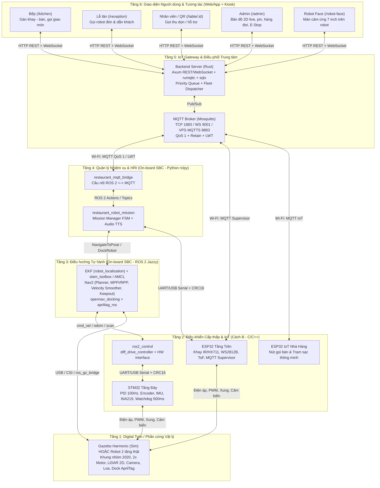
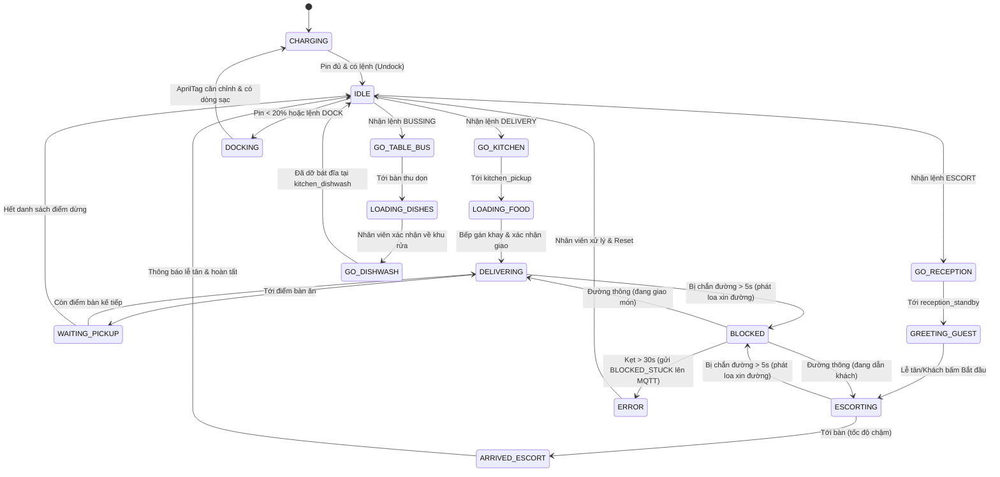

# Kiến Trúc Hệ Thống & Lộ Trình Nghiên Cứu (Bản 2 + Cách B)

## 1. Mục Tiêu Sản Phẩm & Triết Lý Thiết Kế

Hệ thống **Robot tự hành phục vụ nhà hàng** được thiết kế khép kín vòng nghiệp vụ **Bếp ↔ Bàn ăn của khách ↔ Lễ tân / Nhân viên phục vụ ↔ Robot**, triển khai theo chiến lược:

1. **Simulation-First (Digital Twin → Sim-to-Real):** Toàn bộ stack điều hướng, tự sạc, máy trạng thái nhiệm vụ, MQTT gateway, backend Rust và giao diện React được phát triển và kiểm chứng hoàn chỉnh trên **Gazebo Harmonic + ROS 2 Jazzy** trước khi chuyển lên phần cứng thật.
2. **Tách bạch Robotics Real-time vs. IoT Nhà hàng (Bản 2):**
   - Mọi vòng lặp điều khiển sống còn và định vị (`Encoder + PID 100 Hz`, `IMU`, `LiDAR`, `Camera`, `EKF`, `SLAM/AMCL`, `Nav2`, `opennav_docking`) chạy **cục bộ 100% trên thân robot**, không phụ thuộc Wi-Fi.
   - Giao tiếp giữa Robot ↔ Server trung tâm ↔ Thiết bị IoT ngoài nhà hàng sử dụng **MQTT Broker (`Mosquitto`)** theo topic phân tầng (`robot/{id}/...`, `table/{id}/...`, `dock/{id}/...`) giúp tách rời hoàn toàn và sẵn sàng mở rộng đa robot (**Multi-robot Fleet**).
3. **Phân tách phần cứng 2 tầng chuẩn công nghiệp (Cách B):**
   - **STM32 (Tầng đáy — Motion, Power & Safety Core):** chỉ chạy Encoder Hardware Timer, PID vận tốc 50–100 Hz, đọc IMU & INA219, E-Stop cứng và Watchdog 500 ms.
   - **ESP32 (Tầng trên — Tray, Sensor & Supervisor Node):** quản lý cảm biến khay (IR/HX711), dải LED WS2812B, cảm biến ToF tầm gần chống quệt mặt bàn, nút bấm phụ, kiêm kênh **MQTT Supervisor dự phòng** (`robot/{id}/supervisor`) báo tình trạng pin/Pi 5 ngay cả khi SBC bị treo hoặc tắt nguồn khi đang sạc.

---

## 2. Kiến Trúc Tổng Thể 6 Tầng

### Bảng Tóm Tắt Công Nghệ Đã Chốt

| Tầng | Thành phần | Ngôn ngữ / Công nghệ | Nơi chạy |
| :--- | :--- | :--- | :--- |
| **Tầng 6** | 5 giao diện Web & Kiosk | React + Vite + TypeScript + Tailwind CSS + HTML5 Canvas | Tablet / Điện thoại / Laptop / Màn 7" trên Robot |
| **Tầng 5** | Broker + IoT Gateway & Dispatcher | Mosquitto + Rust (`Axum`, `Tokio`, `rumqttc`, `sqlx` SQLite/Postgres) | Mini PC / Laptop / Pi 5 (LAN) hoặc VPS (Docker) |
| **Tầng 4** | Mission Manager, Audio TTS, MQTT Bridge | Python (`rclpy`) trên ROS 2 Jazzy | Raspberry Pi 5 (trên thân robot) |
| **Tầng 3** | EKF, SLAM, AMCL, Nav2, Auto-Docking | ROS 2 Jazzy + `robot_localization` + `slam_toolbox` + `Nav2` + `opennav_docking` + `apriltag_ros` | Raspberry Pi 5 (trên thân robot) |
| **Tầng 2** | Base MCU, Upper MCU, IoT Nodes | C/C++ (STM32, ESP32, `ros2_control`) | STM32 tầng đáy, ESP32 tầng trên, ESP32 IoT rời |
| **Tầng 1** | Digital Twin / Cơ khí & Điện tử | Gazebo Harmonic (`ros_gz`) → Nhôm 2020 + Mica/Alu + In 3D | Máy phát triển (Sim) / Thân robot thật |

---

## 3. Luồng Nghiệp Vụ, Hàng Đợi Ưu Tiên & Máy Trạng Thái

### 3.1. Bản Đồ Ngữ Nghĩa (Semantic Map)
Mọi vị trí chức năng được gắn với `map_id` hiện hành và lưu cả ở server DB lẫn file YAML cấu hình:
- `dock_station` và `pre_dock` (điểm đứng trước trạm sạc ~0.7 m hướng nhìn thấy biển AprilTag).
- `kitchen_pickup` (khu bếp nhận món) và `kitchen_dishwash` (khu rửa bát đĩa).
- `reception_standby` (vị trí trực đón khách tại quầy lễ tân).
- `table_01` … `table_N` (tọa độ `x, y, yaw` sao cho khay hướng thuận tiện về phía bàn ăn).
- **Nav2 Costmap Filters:**
  - *Keepout Zones:* khu bếp nấu nóng, quầy thu ngân, bậc thềm.
  - *Speed Zones:* cửa ra vào bếp, lối đi hẹp (tự giảm tốc độ tối đa).

### 3.2. Hàng Đợi Nhiệm Vụ Có Độ Ưu Tiên (Priority Queue)

Thứ tự ưu tiên từ cao xuống thấp để giải quyết xung đột khi Bếp, Lễ tân và Nhân viên gọi cùng lúc:

| Độ ưu tiên | Giá trị số | Loại tác vụ / Điều kiện | Profile tốc độ mặc định |
| :--- | :---: | :--- | :--- |
| Khẩn cấp | `100` | `ESTOP` / Ngắt khẩn cấp | Dừng tức thì (`0 m/s`) |
| Bảo vệ nguồn | `90` | Pin nguy cấp (`< 15%`) → buộc `DOCK` | `NORMAL` |
| Cao | `70` | `DELIVERY` (Giao đồ ăn nóng từ bếp) | `SMOOTH_LIQUID` |
| Trung bình | `50` | `ESCORT` (Đón & dẫn khách từ lễ tân) | `ESCORT_SLOW` (`0.35–0.45 m/s`) |
| Thấp | `30` | `BUSSING` (Thu dọn bát đĩa / Gọi bàn) | `NORMAL` |
| Nền | `10` | Tự động về sạc khi rảnh lâu & pin `< 85%` | `NORMAL` |

### 3.3. Máy Trạng Thái Tổng Quát (`RobotState` FSM)

---

## 4. Triển Khai Local-First & VPS-Ready

- **Chế độ Demo / Nhà hàng thực tế (Local-First):**
  - Toàn bộ `Mosquitto + Rust Server + React Web` chạy bằng `infra/docker-compose.yml` ngay trong mạng LAN cục bộ (Laptop / Mini PC / Pi 5 kết nối **1 Router Wi-Fi mini riêng** mang theo lúc bảo vệ).
  - Không phụ thuộc Internet, không lo Wi-Fi trường chặn port/multicast, độ trễ `< 5 ms`.
- **Chế độ Quản lý từ xa (VPS-Ready):**
  - Deploy nguyên stack `infra/docker-compose.yml` lên VPS, bật xác thực username/password + phân quyền ACL trong Mosquitto (`infra/mosquitto/config/acl.example`) + TLS/MQTTS (port `8883`) và HTTPS/WSS qua reverse proxy (Caddy/Nginx).
  - Robot và các node ESP32 chỉ cần đổi biến cấu hình `MQTT_BROKER_HOST` và thông tin xác thực.

---

## 5. Lộ Trình Nghiên Cứu & Triển Khai 24 Tuần

| Giai đoạn | Thời gian | Nội dung chính | Milestone |
| :--- | :--- | :--- | :--- |
| **GĐ 1** | Tuần 1–3 | Cài ROS 2 Jazzy + Gazebo Harmonic + Docker + Rust + Node; nắm vững TF2/URDF/`ros2_control`; chốt đặc tả hệ thống & đặt linh kiện BOM sớm. | **M0:** Môi trường & Monorepo chuẩn sẵn sàng |
| **GĐ 2** | Tuần 4–7 | Dựng URDF robot + bản đồ nhà hàng 3D Gazebo (có Actor người đi bộ + dock AprilTag); tích hợp EKF + `slam_toolbox` + Nav2 + Keepout/Speed Zones. | **M1:** Robot mô phỏng tự định vị, chạy giữa các bàn & né người |
| **GĐ 3** | Tuần 8–10 | Tích hợp `opennav_docking` + `apriltag_ros`; viết `mission_manager` FSM, `audio_hri` TTS tiếng Việt, `restaurant_mqtt_bridge`. | **M2:** Điều khiển full luồng Gazebo qua MQTT |
| **GĐ 4** | Tuần 11–13 | Hoàn thiện Rust Server (`Axum + rumqttc + sqlx`), React Web 5 màn hình + Robot Face Kiosk, firmware ESP32 nút gọi bàn đầu tiên. | **M3:** 100% sản phẩm chạy khép kín trên mô phỏng + nút ESP32 thật |
| **GĐ 5** | Tuần 14–18 | Gia công cơ khí khung 2 tầng, mạch nguồn + E-Stop + Smart Dock; code firmware STM32 (PID + Watchdog) & ESP32 tầng trên; `ros2_control` HW Interface; hiệu chuẩn Odometry & Camera trên Pi 5. | **M4:** Robot thật teleop mượt & đủ topic cảm biến/HRI |
| **GĐ 6** | Tuần 19–24 | Sim-to-Real lên robot thật; test đổ nước (velocity smoother); test Auto-docking 20 lượt; đo 6 bảng benchmark; viết luận văn & quay video góc kép dự phòng bảo vệ. | **M5:** Hoàn thiện sản phẩm & Bảo vệ đồ án |

### 6 Chỉ Số Benchmark Đánh Giá Cho Luận Văn
1. Sai số lập bản đồ SLAM so với kích thước đo thật (cm / %).
2. Sai số dừng tại bàn (`Δx, Δy` theo cm; `Δyaw` theo độ) qua 20 lượt chạy.
3. Đồ thị gia tốc trục X/Y đo từ IMU trước và sau khi bật `nav2_velocity_smoother` (chống đổ đồ uống).
4. Tỷ lệ hoàn thành chuyến và thời gian phản ứng khi gặp vật cản tĩnh & người đi bộ cắt ngang.
5. Tỷ lệ thành công Auto-docking (`/20` lượt) và thời gian trung bình vào sạc.
6. Độ trễ end-to-end (`ESP32/Web → MQTT → Rust Server → Robot`) khi có nhiều lệnh đồng thời từ Bếp, Lễ tân và Nhân viên.

### 5 Cạm Bẫy Kinh Điển Cần Phòng Tránh
1. **Điểm mù mặt bàn của LiDAR 2D:** luôn cấu hình `footprint` phủ rộng hơn tầng khay trên cùng, kết hợp Keepout Zone và cảm biến ToF trên ESP32 tầng trên.
2. **Trượt bánh trên sàn gạch men:** bắt buộc kết hợp Wheel Odometry + IMU qua EKF (`robot_localization`).
3. **Đổ đồ uống khi phanh/quay:** bắt buộc bật `nav2_velocity_smoother` và dùng profile `SMOOTH_LIQUID` (`acc_lim_x <= 0.3 m/s²`) khi giao món.
4. **Rớt mạng / Wi-Fi trường chặn DDS:** ROS 2 chạy nội bộ trên Pi 5, bên ngoài qua MQTT trên **Router Wi-Fi riêng**.
5. **Treo SBC gây mất kiểm soát:** bắt buộc có **Watchdog 500 ms** trên firmware STM32 và **nút E-Stop cứng** ngắt nguồn động cơ.
